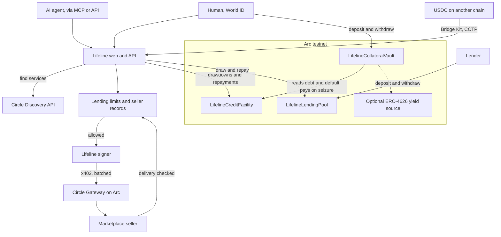

# Lifeline at ETHGlobal Mumbai

Continuity track. Everything before tag `pre-mumbai` (commit `f5df633`) is the
project as submitted at [ETHGlobal Tokyo](https://ethglobal.com/showcase/lifeline-mygz6).
Everything after it is new. See exactly what changed with:

```bash
git diff pre-mumbai HEAD --stat
```

**Bounty:** Arc Studio Continuity Track: Bring Your Project to Arc.

## What is new

| Feature | Where | What it does |
|---|---|---|
| Real marketplace | `web/src/lib/discovery.ts`, `GET /api/x402/discover`, MCP `lifeline_discover` | Agents find Circle marketplace services that take Gateway payments on Arc testnet, and buy them on credit |
| Seller records | `web/src/lib/sellerQuality.ts` | Each purchase is scored against the format the seller published. Sellers with a poor record rank last and are not lent against |
| Lending limits | `web/src/lib/riskControls.ts`, `GET /api/risk/controls` | A cap on total lending, a daily budget, a per-seller limit, a refusal to pay yourself with credit, and an automatic stop when too many due loans are unpaid |
| Deposit-backed credit | `contracts/src/LifelineCollateralVault.sol`, `web/src/lib/securedLine.ts`, `/api/secured` | A deposit raises the line. In default, anyone can trigger the deposit paying the debt |
| Lending pool | `contracts/src/LifelineLendingPool.sol`, `GET /api/pool` | Lenders fund the credit and earn borrowers' payments, with limits enforced in the contract |
| Cross-chain repayment | `web/src/lib/crosschainRepay.ts`, `POST /api/repay/crosschain` | Bridge Kit moves an agent's USDC to Arc, then repays the debt with what arrived |

## Architecture



## Deliberate limits

- **Testnet only.** Nothing here has been used with real money.
- **No new screens.** The interface was kept exactly as it was. The new features
  are reachable through the API and MCP tools.
- **The operator is trusted** to repay the pool and report losses honestly. The
  pool's limits bound what that trust can cost, and do not remove it.
- **Yield:** the vault takes any ERC-4626 source. Whether Arc's Earn vaults can
  plug in directly has not been confirmed, so no yield source is configured.
- **Marketplace on testnet:** 134 listings take Arc testnet payments, mostly
  Quicknode RPC access, and most of those want wallet sign-in as well.

## Arc Studio

Every Arc prize requires building in Arc Studio, with a project URL judges can
open. See [arc-studio.md](arc-studio.md) for the status and the steps.

## How AI was used

Claude Code wrote the code in this phase under the direction of the team, who
chose the features, set the constraints, and reviewed the results. Planning
decisions and prompts are recorded in [prompts.md](prompts.md).

## Run it

```bash
npm install
cp .env.example .env     # the keys are listed there
npm run dev              # http://localhost:3000
npm run test:contracts
npm --workspace=web run test
```

Deploy the new contracts next to the existing facility:

```bash
cd contracts
forge script script/DeploySecured.s.sol --rpc-url arc_testnet --broadcast
```

Then set `LIFELINE_COLLATERAL_VAULT_ADDRESS` and `LIFELINE_LENDING_POOL_ADDRESS`.
