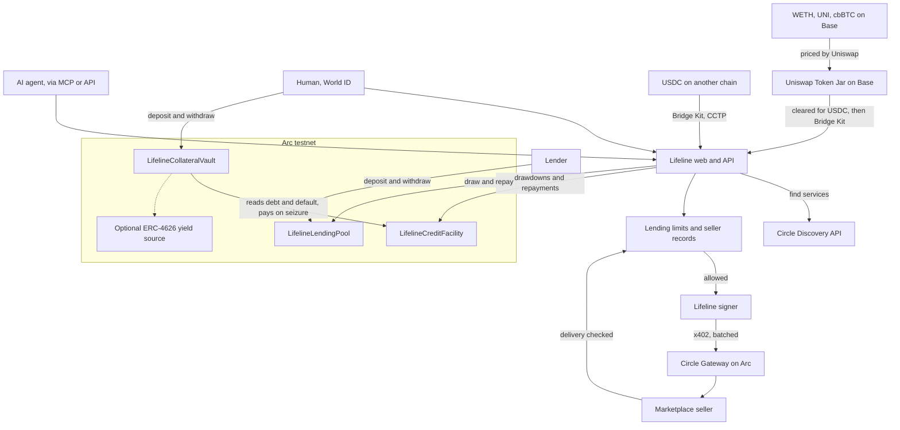

# Lifeline at ETHGlobal Mumbai

Continuity track. Everything before tag `pre-mumbai` (commit `f5df633`) is the
project as submitted at [ETHGlobal Tokyo](https://ethglobal.com/showcase/lifeline-mygz6).
Everything after it is new. See exactly what changed with:

```bash
git diff pre-mumbai HEAD --stat
```

**Bounties:** Arc Studio Continuity Track: Bring Your Project to Arc. Uniswap, see [uniswap.md](uniswap.md). Whitechain, see [whitechain.md](whitechain.md).

## What is new

| Feature | Where | What it does |
|---|---|---|
| Real marketplace | `web/src/lib/discovery.ts`, `GET /api/x402/discover`, MCP `lifeline_discover` | Agents find Circle marketplace services that take Gateway payments on Arc testnet, and buy them on credit |
| Seller records | `web/src/lib/sellerQuality.ts` | Each purchase is scored against the format the seller published. Sellers with a poor record rank last and are not lent against |
| Lending limits | `web/src/lib/riskControls.ts`, `GET /api/risk/controls` | A cap on total lending, a daily budget, a per-seller limit, a refusal to pay yourself with credit, and an automatic stop when too many due loans are unpaid |
| Deposit-backed credit | `contracts/src/LifelineCollateralVault.sol`, `web/src/lib/securedLine.ts`, `/api/secured` | A deposit raises the line. In default, anyone can trigger the deposit paying the debt |
| Lending pool | `contracts/src/LifelineLendingPool.sol`, `GET /api/pool` | Lenders fund the credit and earn borrowers' payments, with limits enforced in the contract |
| New credit tiers | `web/src/lib/reputationEngine.ts` | Unsecured lines start at $0.50, then $1 and $2. A deposit raises them further |
| Screens for all of this | `web/src/components/arc/` | Marketplace, deposit-backed credit, lending pool, limits and cross-chain repayment on the Arc dashboard |
| Repay in any token | `web/src/lib/lifelineJar.ts`, `/api/jar`, [uniswap.md](uniswap.md) | Agents pay debt with tokens on Base through a Uniswap Token Jar. Built and tested on a fork, not deployed |
| USDT credit on Whitechain | `web/src/lib/whitechain/`, `/whitechain`, [whitechain.md](whitechain.md) | An x402 facilitator and gasless payments in USDT, so an agent with no WBT and no USDT can buy on credit |
| A switch to mainnet | `NEXT_PUBLIC_ARC_NETWORK`, [mainnet.md](mainnet.md) | One setting moves all of Arc to mainnet. Not yet run with real money |
| Cross-chain repayment | `web/src/lib/crosschainRepay.ts`, `POST /api/repay/crosschain` | Bridge Kit moves an agent's USDC to Arc, then repays the debt with what arrived |

## Architecture



## What runs on Arc

| Arc or Circle piece | How Lifeline uses it | Tested live |
|---|---|---|
| Nanopayments (Circle Gateway, x402 batching) | Every agent purchase, from its own balance or on credit | Yes, settlement IDs returned |
| Discovery API | The marketplace: 134 services that accept Arc testnet | Yes, including a purchase from a real seller |
| USDC as gas | All contracts and wallets | Yes |
| Bridge Kit (CCTP) | Repaying Arc debt from other chains | Yes: USDC from Base Sepolia repaid a debt on the live site |
| Borrow Kit | Not used on purpose: it lends USDC against cirBTC, and Lifeline is the lender | n/a |
| Earn (ERC-4626 "Morpho USDC Vault", `0x8f2d…d2dc`) | Deposits earn while they back credit | Yes, deposit and seizure through it. It is Arc testnet's vault, listed as a mock of Morpho |
| Arc Studio | Contracts, tests, screens, deployment | Yes |

## Deliberate limits

- **Testnet only.** Nothing here has been used with real money.
- **The operator is trusted** to repay the pool and report losses honestly. The
  pool's limits bound what that trust can cost, and do not remove it.
- **The pool backs loans when it has room.** A loan's principal is drawn from the pool to
  the operator, and the repayment returns with what the borrower paid on top. With no
  room, the operator funds the loan itself and lenders earn nothing on it.
- **Pool interest** goes to whoever is in the pool when it is repaid. The one-day lockup
  delays timing that, and does not remove it.
- **Marketplace on testnet:** 134 listings take Arc testnet payments, mostly
  Quicknode RPC access, and most of those want wallet sign-in as well.
- **No paid audit.** The contracts were reviewed in Arc Studio and tested, not audited.

## Arc Studio

The new contracts and screens were built in Arc Studio and deployed from it. See
[arc-studio.md](arc-studio.md) for the project link, the addresses, how they were
checked, and what is still needed before submitting.

## How AI was used

Claude Code and Arc Studio's agent wrote the code in this phase under the direction of
the team, who chose the features, set the constraints, and reviewed the results. Planning
decisions and prompts are recorded in [prompts.md](prompts.md).

## Run it

```bash
npm install
cp .env.example .env     # the keys are listed there
npm run dev              # http://localhost:3000
npm run test:contracts
npm --workspace=web run test
```

The deployed addresses are in `.env.example`. To test the new features live:

```bash
npm run e2e:secured
```
